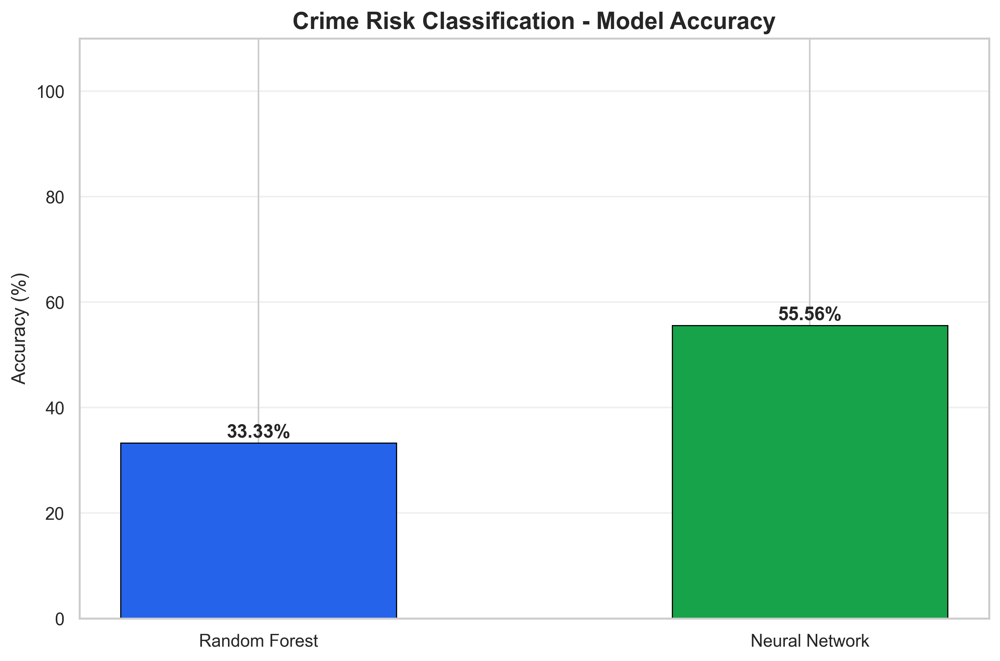
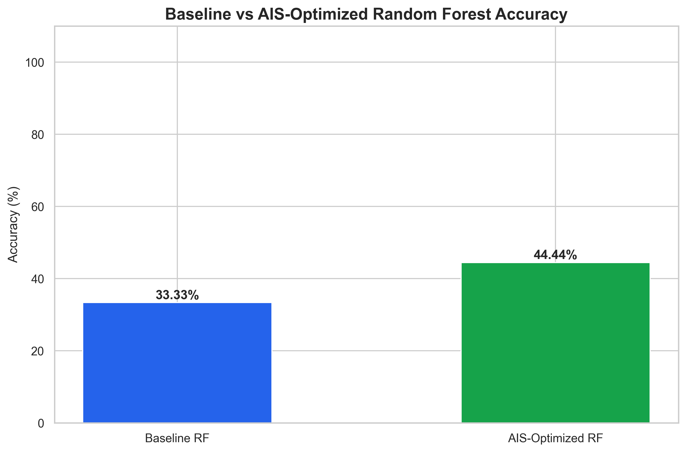
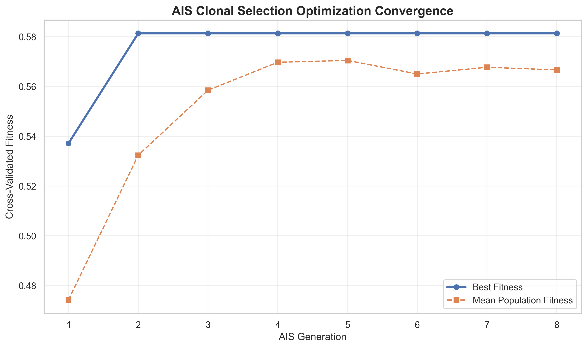
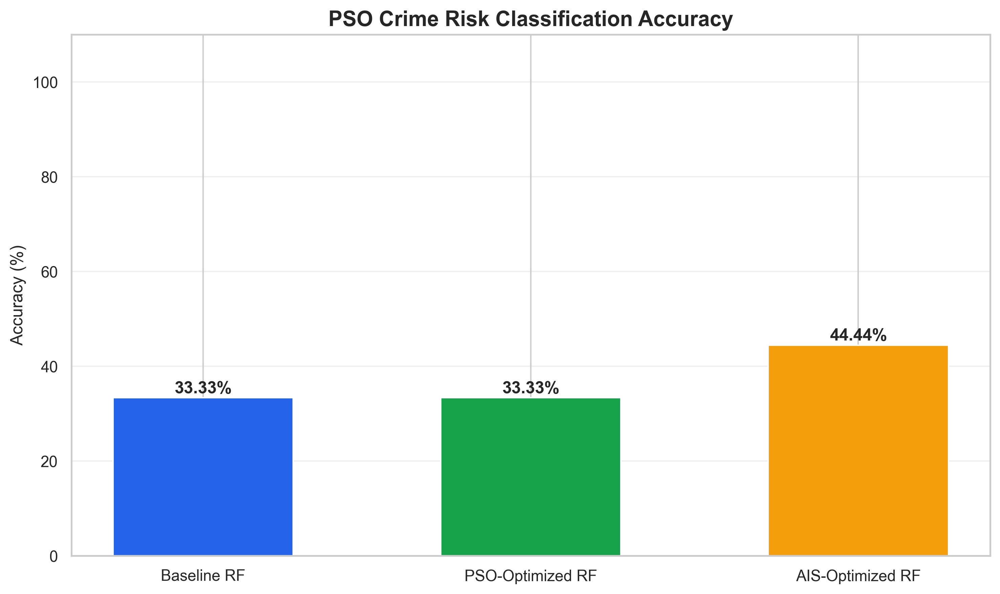
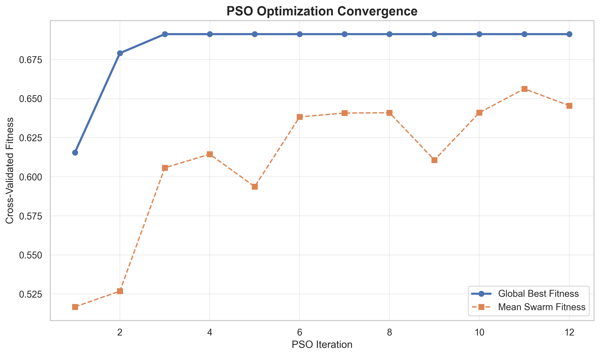
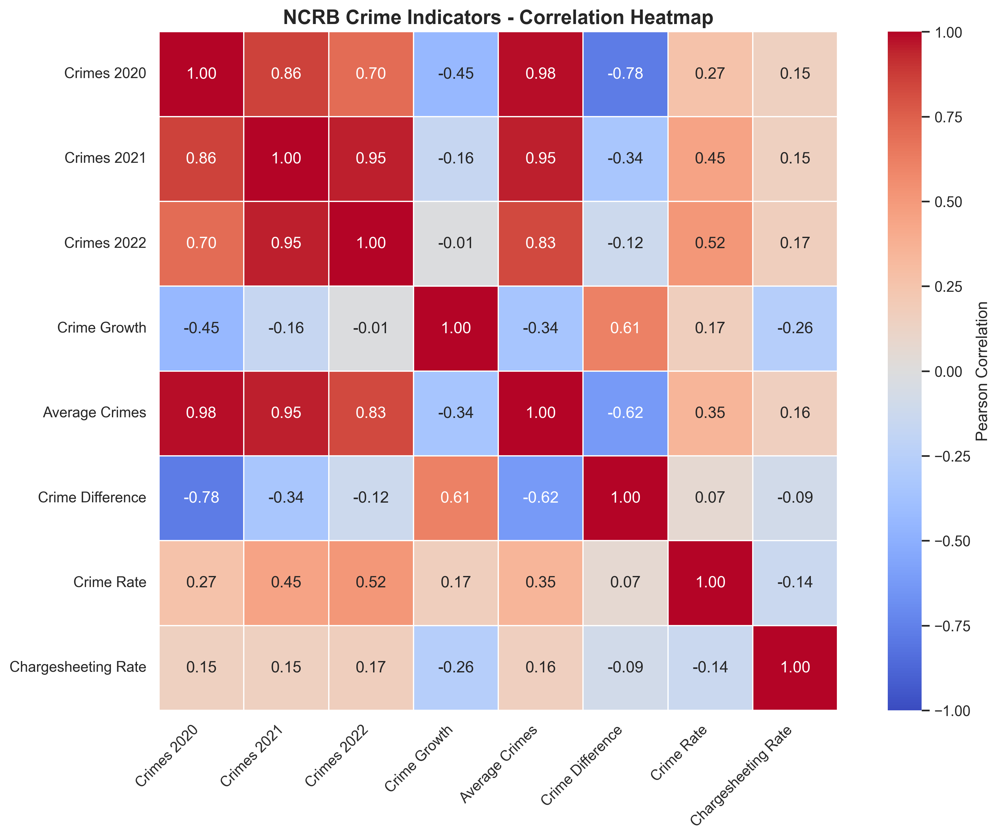
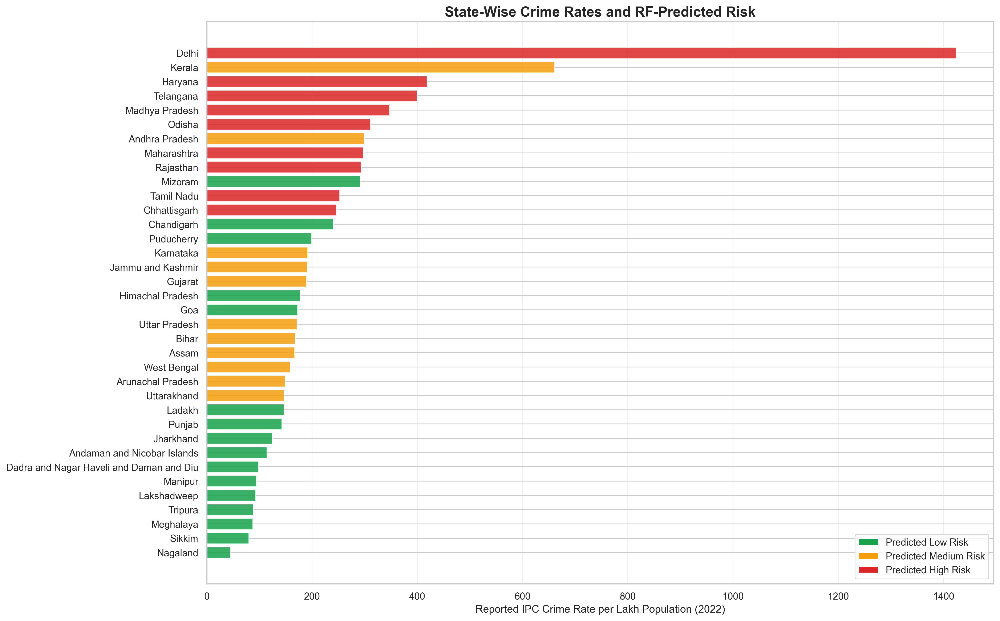
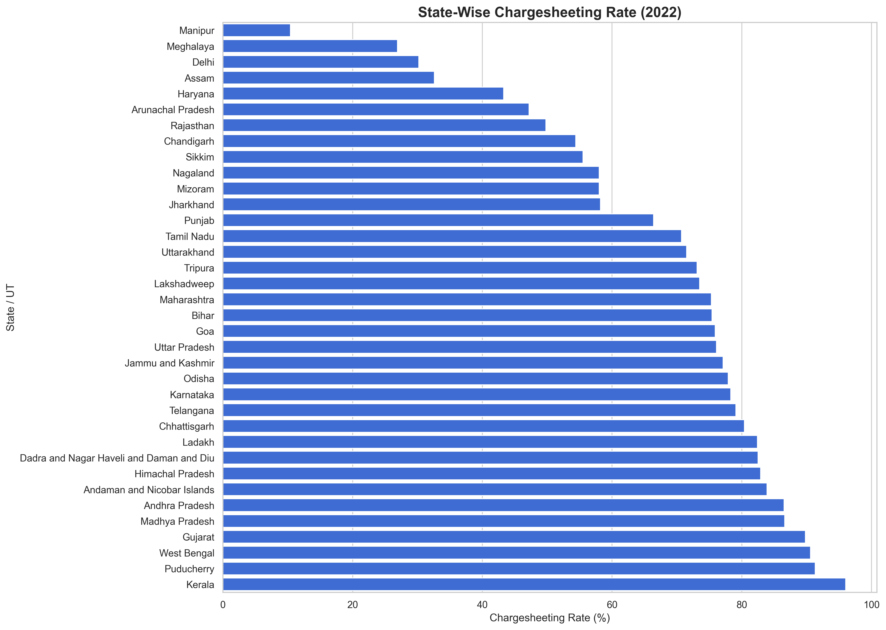
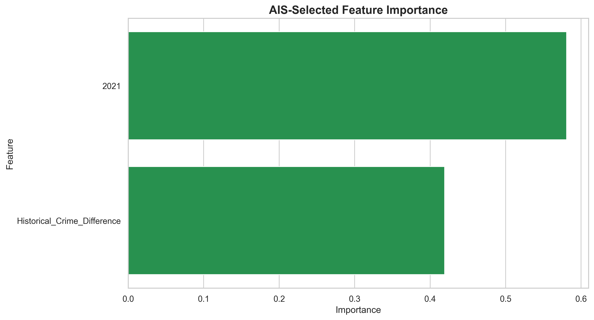
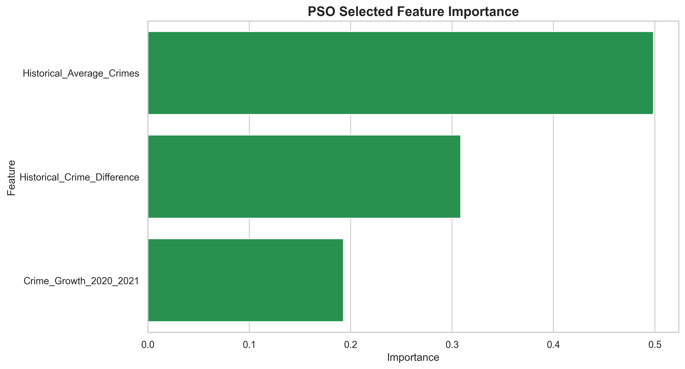

# AI-Based State-Wise Crime Risk Assessment and Law Enforcement Efficiency Analysis Using Machine Learning, AIS, and PSO

## Overview

This project presents an Artificial Intelligence-based framework for analyzing state-wise crime patterns, classifying relative crime risk, and examining law-enforcement performance indicators across India.

The system uses crime statistics from the National Crime Records Bureau (NCRB) for 2020, 2021, and 2022.

Three machine learning approaches are investigated:

1. Baseline Machine Learning
2. Artificial Immune System (AIS)-Optimized Machine Learning
3. Particle Swarm Optimization (PSO)-Optimized Machine Learning

The primary objective is to investigate whether bio-inspired optimization algorithms can improve crime-risk classification performance through hyperparameter optimization and feature selection.

The project also examines state-wise crime trends, population-adjusted crime rates, and chargesheeting rates.

The framework is intended for exploratory research, statistical analysis, and comparative machine learning experimentation.

---

## Project Visualization

### Crime Risk Classification Accuracy

The following graph compares the classification accuracy of the baseline machine learning models.



The accuracy graph presents the performance of the baseline Random Forest and Artificial Neural Network models on the held-out test dataset.

Additional optimization-specific visualizations are available:

- `ais_accuracy_graph.png` — Baseline versus AIS-optimized Random Forest.
- `pso_accuracy_graph.png` — Baseline versus PSO-optimized Random Forest, with AIS included when available.
- `comparison_graph.png` — Baseline model performance comparison.
- `ais_comparison_graph.png` — AIS optimization performance comparison.
- `pso_comparison_graph.png` — PSO optimization performance comparison.

These visualizations support comparative evaluation of classification accuracy, precision, recall, and F1-score.

---

## Research Objectives

The major objectives of this project are:

1. Analyze state-wise registered crime patterns across India.
2. Examine changes in registered IPC crimes between 2020 and 2022.
3. Categorize states and Union Territories into relative crime-risk groups.
4. Develop machine learning models for crime-risk classification.
5. Apply Artificial Immune System optimization for hyperparameter tuning and feature selection.
6. Apply Particle Swarm Optimization for classifier optimization.
7. Compare baseline, AIS, and PSO model performance.
8. Analyze chargesheeting rates as a descriptive law-enforcement indicator.
9. Generate state-wise classification results and visualizations.
10. Develop a reproducible experimental framework for further research.

---

## Dataset Description

### Dataset Source

National Crime Records Bureau (NCRB), India.

Dataset file:

`NCRB_Table_1A.1.csv`

The dataset contains state-wise and Union Territory-wise information about registered IPC crimes and related statistical indicators.

### Dataset Characteristics

| Attribute | Description |
|---|---|
| Dataset | NCRB Table 1A.1 |
| Country | India |
| Observation Period | 2020–2022 |
| Original Records | 39 |
| Individual State/UT Records | 36 |
| Original Attributes | 8 |
| Data Type | Structured tabular data |
| Primary Task | Multiclass classification |
| Target Variable | Crime Risk Category |
| Risk Categories | Low, Medium, High |

Aggregate records are excluded from model training to prevent national or regional totals from being treated as individual states.

### Dataset Attributes

| Attribute | Description |
|---|---|
| State/UT | State or Union Territory |
| 2020 | Registered IPC crimes in 2020 |
| 2021 | Registered IPC crimes in 2021 |
| 2022 | Registered IPC crimes in 2022 |
| Mid-Year Projected Population | Estimated population in lakhs for 2022 |
| Rate of Cognizable Crimes | Reported IPC crime rate for 2022 |
| Chargesheeting Rate | Chargesheeting percentage for 2022 |

### Data Preprocessing

The following preprocessing operations are performed:

- Removal of aggregate rows.
- Conversion of numeric columns.
- Handling of missing and invalid values.
- Historical feature engineering.
- Crime-risk category generation.
- Feature scaling where required.
- Stratified train-test splitting.
- Model-specific feature selection.

The model uses historical crime counts from 2020 and 2021 to estimate relative risk categories derived from 2022 crime rates.

The 2022 crime counts, 2022 crime rates, and 2022 chargesheeting rates are excluded from predictive input features.

---

## Feature Engineering

Historical crime statistics are transformed into additional features to capture changes in registered crime patterns.

### 1. Crime Growth Rate

The percentage change in registered crimes between 2020 and 2021 is calculated as:

\[
CrimeGrowth =
\frac{Crimes_{2021}-Crimes_{2020}}
{Crimes_{2020}}
\times 100
\]

This feature captures historical increases or decreases in registered crimes.

### 2. Historical Average Crimes

\[
AverageCrimes =
\frac{Crimes_{2020}+Crimes_{2021}}{2}
\]

This feature represents the average number of registered crimes during the historical observation period.

### 3. Historical Crime Difference

\[
CrimeDifference =
Crimes_{2021}-Crimes_{2020}
\]

This feature captures the absolute change in registered crimes.

### Input Features

The candidate input features are:

- Registered Crimes in 2020
- Registered Crimes in 2021
- Crime Growth Rate (2020–2021)
- Historical Average Crimes
- Historical Crime Difference

AIS and PSO independently select subsets of these candidate features.

---

## Crime Risk Classification

The target variable is generated using the distribution of reported 2022 IPC crime rates.

Three relative crime-risk categories are defined:

| Category | Classification Rule |
|---|---|
| Low Risk | Crime rate at or below the first tertile |
| Medium Risk | Crime rate above the first tertile and at or below the second tertile |
| High Risk | Crime rate above the second tertile |

These categories are derived from the dataset distribution.

They are not official NCRB risk classifications.

The classification describes relative reported crime-rate levels and should not be interpreted as a direct measure of personal safety, criminality, or policing quality.

---

## Proposed System Architecture

The overall architecture consists of six major stages.

### Stage 1: Data Collection

The NCRB dataset is loaded from a CSV file.

### Stage 2: Data Preprocessing

Aggregate records are removed, numerical features are cleaned, and historical features are generated.

### Stage 3: Risk Category Generation

States and Union Territories are categorized using reported 2022 crime-rate tertiles.

### Stage 4: Machine Learning

Baseline classification models are trained using historical features.

### Stage 5: Bio-Inspired Optimization

Two optimization algorithms are applied:

- Artificial Immune System
- Particle Swarm Optimization

### Stage 6: Evaluation and Visualization

Models are evaluated using classification metrics and visualized through graphs, heatmaps, confusion matrices, and state-wise prediction charts.

### Workflow

```text
NCRB Crime Dataset
        |
        v
Data Cleaning and Preprocessing
        |
        v
Historical Feature Engineering
        |
        v
Crime Risk Category Generation
        |
        v
Stratified Train-Test Split
        |
        +------------------------+
        |                        |
        v                        v
Baseline ML Models      Bio-Inspired Optimization
        |                        |
        |                 +------+------+
        |                 |             |
        |                 v             v
        |                AIS           PSO
        |                 |             |
        |                 v             v
        |           Optimized RF   Optimized RF
        |                 |             |
        +-----------------+-------------+
                          |
                          v
                Model Evaluation
                          |
                          v
              Performance Comparison
                          |
                          v
              Results and Visualization
```

---

## Machine Learning Models

### 1. Random Forest Classifier

Random Forest is an ensemble learning algorithm that combines multiple decision trees.

Each tree generates a prediction, and the final classification is determined through voting.

Advantages include:

- Ability to model nonlinear relationships.
- Support for feature importance analysis.
- Robustness to different feature scales.
- Compatibility with feature-selection methods.
- Relatively simple hyperparameter optimization.

The baseline Random Forest uses fixed hyperparameters.

### 2. Artificial Neural Network

A feedforward Artificial Neural Network is implemented using TensorFlow/Keras.

The network architecture includes:

| Layer | Configuration |
|---|---|
| Input Layer | Historical crime features |
| Hidden Layer 1 | 32 neurons, ReLU |
| Dropout | 0.2 |
| Hidden Layer 2 | 16 neurons, ReLU |
| Output Layer | 3 neurons, Softmax |

The neural network is trained using:

- Adam optimizer
- Sparse categorical cross-entropy
- Early stopping
- Standardized numerical features

The neural network provides an additional baseline for comparison with the Random Forest classifier.

Because the dataset is small, neural network results may be unstable and require careful validation.

---

## Artificial Immune System (AIS)

### Introduction

Artificial Immune Systems are computational optimization approaches inspired by biological immune mechanisms.

This project uses a Clonal Selection Algorithm (CLONALG-inspired approach) to optimize Random Forest hyperparameters and feature selection.

### AIS Optimization Process

1. Initialize a population of candidate solutions called antibodies.
2. Encode Random Forest hyperparameters and feature-selection masks.
3. Evaluate each antibody using cross-validated classification performance.
4. Select high-fitness antibodies.
5. Generate clones from selected antibodies.
6. Apply mutation to explore new solutions.
7. Preserve stronger candidates.
8. Repeat the process for multiple generations.
9. Train the final optimized Random Forest.
10. Evaluate the final classifier on the held-out test dataset.

### AIS Configuration

| Parameter | Value |
|---|---|
| Population Size | 10 |
| Generations | 8 |
| Elite Antibodies | 4 |
| Clones per Elite | 3 |
| Random Replacements | 2 |
| Cross-Validation | 3-fold Stratified |
| Fitness Metric | Macro F1-score |
| Base Classifier | Random Forest |

### AIS Optimization Targets

The AIS algorithm optimizes:

- Number of decision trees
- Maximum tree depth
- Minimum samples required for splitting
- Minimum samples per leaf
- Maximum feature fraction
- Feature-selection mask

### AIS Fitness Function

The optimization objective is:

\[
Fitness =
MacroF1_{CV}
-
\lambda \frac{k}{K}
\]

Where:

- \(MacroF1_{CV}\) is the mean cross-validated macro F1-score.
- \(k\) is the number of selected features.
- \(K\) is the total number of candidate features.
- \(\lambda\) is the feature complexity penalty coefficient.

The implementation uses a small penalty coefficient of 0.005.

### AIS Outputs

The AIS implementation generates:

- Optimized model
- Selected features
- Optimized hyperparameters
- Classification metrics
- Confusion matrix
- Optimization convergence graph
- Feature importance graph
- State-wise predictions
- Test-set classification results

---

## Particle Swarm Optimization (PSO)

### Introduction

Particle Swarm Optimization is a population-based optimization algorithm inspired by collective movement and social behavior.

In this project, PSO optimizes Random Forest hyperparameters and selects relevant historical crime features.

Each particle represents a candidate Random Forest configuration.

### PSO Optimization Process

1. Initialize particles with random positions.
2. Encode hyperparameters and feature-selection scores.
3. Evaluate each particle using cross-validation.
4. Store each particle's personal best position.
5. Identify the global best solution.
6. Update particle velocities.
7. Update particle positions.
8. Apply parameter bounds.
9. Repeat the optimization process.
10. Train the final optimized Random Forest model.

### PSO Velocity Update

\[
v_i^{t+1} =
w v_i^t +
c_1r_1(pbest_i-x_i^t) +
c_2r_2(gbest-x_i^t)
\]

Where:

- \(v_i\) is particle velocity.
- \(x_i\) is particle position.
- \(w\) is inertia weight.
- \(c_1\) is the cognitive coefficient.
- \(c_2\) is the social coefficient.
- \(r_1,r_2\) are random values.
- \(pbest\) is personal best.
- \(gbest\) is global best.

### PSO Position Update

\[
x_i^{t+1} = x_i^t + v_i^{t+1}
\]

### PSO Configuration

| Parameter | Value |
|---|---|
| Number of Particles | 12 |
| Iterations | 12 |
| Inertia Weight | 0.7 |
| Cognitive Coefficient | 1.5 |
| Social Coefficient | 1.5 |
| Cross-Validation | 3-fold Stratified |
| Fitness Metric | Macro F1-score |
| Base Classifier | Random Forest |

### PSO Optimization Targets

The PSO algorithm optimizes:

- Number of decision trees
- Maximum tree depth
- Minimum samples required for splitting
- Minimum samples per leaf
- Maximum feature fraction
- Feature-selection scores

### PSO Fitness Function

The implementation minimizes:

\[
Cost =
-\left(
MacroF1_{CV}
-
\lambda\frac{k}{K}
\right)
\]

This transforms macro F1-score maximization into a minimization problem.

---

## Model Evaluation Metrics

The following metrics are used to evaluate model performance.

### Accuracy

\[
Accuracy =
\frac{TP+TN}{TP+TN+FP+FN}
\]

Accuracy measures the proportion of correctly classified observations.

### Precision

\[
Precision =
\frac{TP}{TP+FP}
\]

Precision measures how many predicted positive observations are actually positive.

### Recall

\[
Recall =
\frac{TP}{TP+FN}
\]

Recall measures the proportion of actual positive observations correctly identified.

### F1-Score

\[
F1 =
2\times
\frac{Precision\times Recall}
{Precision+Recall}
\]

F1-score balances precision and recall.

### Macro F1-Score

Macro F1-score calculates the average F1-score across all classes with equal class weighting.

It is used as the primary optimization metric in AIS and PSO.

### Balanced Accuracy

Balanced accuracy calculates the average recall across the classification categories.

It is useful when class distributions are unequal.

### Confusion Matrix

The confusion matrix displays the number of correctly and incorrectly classified observations for each crime-risk category.

---

## Experimental Setup

### Data Splitting

The dataset is divided into:

- 75% training data
- 25% testing data

A stratified split preserves the approximate class distribution.

Random seed:

`42`

### Optimization Validation

AIS and PSO use 3-fold stratified cross-validation within the training dataset.

The held-out test set is used for final model evaluation.

### Model Comparison

The primary comparison involves:

| Model | Description |
|---|---|
| Random Forest | Baseline ensemble classifier |
| Artificial Neural Network | Baseline deep learning classifier |
| AIS-Random Forest | AIS-optimized ensemble classifier |
| PSO-Random Forest | PSO-optimized ensemble classifier |

The optimization experiments focus on comparing AIS and PSO against the baseline Random Forest.

---

## Project Directory Structure

```text
AI-Based State-Wise Crime Risk Assessment and Law Enforcement Efficiency Analysis/
│
├── NCRB_Table_1A.1.csv
│
├── crime_risk_model.h5
├── crime_risk_model.pkl
├── nn_preprocessor.pkl
├── config.yaml
├── model_info.json
│
├── accuracy_graph.png
├── heatmap.png
├── comparison_graph.png
├── result.csv
├── result_graph.png
├── prediction.csv
├── prediction_graph.png
├── confusion_matrix.png
├── classification_report.csv
├── model_comparison.csv
├── chargesheeting_graph.png
│
├── ais_crime_risk_model.pkl
├── ais_config.yaml
├── ais_model_info.json
├── ais_accuracy_graph.png
├── ais_heatmap.png
├── ais_comparison_graph.png
├── ais_result.csv
├── ais_result_graph.png
├── ais_prediction.csv
├── ais_prediction_graph.png
├── ais_confusion_matrix.png
├── ais_optimization_graph.png
├── ais_optimization_history.csv
├── ais_classification_report.csv
├── ais_model_comparison.csv
├── ais_feature_importance.csv
├── ais_feature_importance.png
│
├── pso_crime_risk_model.pkl
├── pso_config.yaml
├── pso_model_info.json
├── pso_accuracy_graph.png
├── pso_heatmap.png
├── pso_comparison_graph.png
├── pso_result.csv
├── pso_result_graph.png
├── pso_prediction.csv
├── pso_prediction_graph.png
├── pso_confusion_matrix.png
├── pso_optimization_graph.png
├── pso_optimization_history.csv
├── pso_classification_report.csv
├── pso_model_comparison.csv
├── pso_feature_importance.csv
├── pso_feature_importance.png
│
└── README.md
```

The listed files are expected outputs of the corresponding scripts. They are generated when those scripts execute successfully.

---

## Installation Requirements

### Programming Language

Python 3.10 or later with compatible library versions.

### Required Libraries

- NumPy
- Pandas
- Scikit-learn
- TensorFlow
- Matplotlib
- Seaborn
- PyYAML
- Joblib
- Jupyter Notebook

### Install Dependencies

```bash
pip install numpy pandas scikit-learn tensorflow matplotlib seaborn pyyaml joblib notebook
```

### Start Jupyter Notebook

```bash
jupyter notebook
```

---

## How to Run the Project

### Step 1: Download the Dataset

Place the NCRB dataset in the project directory.

```text
NCRB_Table_1A.1.csv
```

### Step 2: Configure the Dataset Path

Use the following path in the Python scripts:

```python
PROJECT_DIR = (
    r"C:\Users\sagni\Downloads"
    r"\AI-Based State-Wise Crime Risk Assessment "
    r"and Law Enforcement Efficiency Analysis"
)
```

### Step 3: Train Baseline Models

Run the baseline machine learning notebook.

The notebook generates:

- `crime_risk_model.h5`
- `crime_risk_model.pkl`
- `nn_preprocessor.pkl`
- `config.yaml`
- `model_info.json`

### Step 4: Generate Baseline Visualizations

Run the visualization notebook.

The notebook generates:

- Accuracy graph
- Correlation heatmap
- Model comparison graph
- Result CSV
- Result graph
- Prediction CSV
- Prediction graph
- Confusion matrices
- Classification reports
- Chargesheeting analysis graph

### Step 5: Execute AIS Optimization

Run the AIS implementation.

The algorithm performs clonal selection optimization and saves results with the `ais_` prefix.

### Step 6: Execute PSO Optimization

Run the PSO implementation.

The algorithm performs particle swarm optimization and saves results with the `pso_` prefix.

### Step 7: Compare Models

Compare the following evaluation metrics:

- Accuracy
- Precision
- Recall
- Weighted F1-score
- Macro F1-score
- Balanced Accuracy

Use the generated comparison CSV files and graphs to examine model performance.

---

## Results and Analysis

### Baseline Model Performance

The baseline implementation evaluates Random Forest and Artificial Neural Network classifiers.


The corresponding performance metrics are saved in:

`model_info.json`

### AIS Optimization Results

The AIS model performs feature selection and hyperparameter optimization using clonal selection.



The AIS optimization convergence is shown below.



Numerical results are saved in:

- `ais_model_info.json`
- `ais_model_comparison.csv`
- `ais_classification_report.csv`

### PSO Optimization Results

The PSO model performs hyperparameter optimization using swarm intelligence.



The optimization convergence is shown below.



Numerical results are saved in:

- `pso_model_info.json`
- `pso_model_comparison.csv`
- `pso_classification_report.csv`

### Comparative Analysis

The baseline, AIS, and PSO approaches can be compared using the following experimental structure.

| Metric | Baseline RF | AIS-RF | PSO-RF |
|---|---|---|---|
| Accuracy | See generated CSV | See generated CSV | See generated CSV |
| Precision | See generated CSV | See generated CSV | See generated CSV |
| Recall | See generated CSV | See generated CSV | See generated CSV |
| Weighted F1 | See generated CSV | See generated CSV | See generated CSV |
| Macro F1 | See generated CSV | See generated CSV | See generated CSV |
| Balanced Accuracy | See generated CSV | See generated CSV | See generated CSV |

Actual numerical values depend on the executed experiments.

No performance improvement is assumed in advance.

### Interpretation

The comparative evaluation is intended to investigate:

1. Whether AIS improves Random Forest classification performance.
2. Whether PSO improves Random Forest classification performance.
3. Which optimization method selects fewer or more informative features.
4. How optimization fitness changes across generations or iterations.
5. Whether optimized models improve performance relative to the baseline.
6. Whether performance differences remain stable under repeated evaluation.

---

## Correlation Analysis

Correlation analysis examines statistical relationships between historical crime indicators and the reported 2022 crime statistics.



The heatmap includes:

- Historical registered crime counts
- Crime growth
- Historical average crimes
- Crime differences
- Reported crime rate
- Chargesheeting rate

The heatmap is descriptive.

Correlation does not establish causation.

---

## State-Wise Crime Risk Analysis

The system generates relative crime-risk classifications for individual states and Union Territories.

The prediction output includes:

- State/UT name
- Historical crime counts
- Reported 2022 crime rate
- Actual risk category derived from the dataset
- Predicted risk category
- Model prediction confidence
- Training or testing subset identification

### State-Wise Prediction Visualization



The graph displays reported 2022 crime rates, with colors representing the model-predicted risk categories.

### Prediction Results

The following files contain the model outputs:

- `prediction.csv`
- `ais_prediction.csv`
- `pso_prediction.csv`

These files include predictions for both training and testing observations.

They should not be interpreted as independent external validation or future crime forecasts.

---

## Law Enforcement Efficiency Analysis

The project also examines chargesheeting rates across Indian states and Union Territories.

### Chargesheeting Rate Analysis



Chargesheeting rate is used as a descriptive indicator of case-processing outcomes.

The analysis examines:

- State-wise chargesheeting rates
- Differences between states and Union Territories
- Distribution of chargesheeting percentages
- Relationships between chargesheeting rates and reported crime indicators

Chargesheeting rate alone cannot establish overall law-enforcement effectiveness.

Factors such as crime type, reporting practices, case complexity, investigation resources, and judicial processes may influence the observed values.

---

## Feature Importance Analysis

Random Forest feature importance is used to examine the relative contribution of selected features.

### AIS Feature Importance



### PSO Feature Importance



Feature importance values are model-specific and do not demonstrate causal relationships.

Because several historical crime features are mathematically related, their individual importance values may be unstable.

---

## Research Contributions

The project investigates the following contributions:

### 1. Comparative Bio-Inspired Optimization

A common crime-risk classification task is used to compare AIS and PSO optimization approaches.

### 2. Joint Hyperparameter and Feature Optimization

Both optimization algorithms search over Random Forest hyperparameters and feature subsets.

### 3. Historical Crime Feature Engineering

Crime growth, historical averages, and absolute changes are used to represent historical crime patterns.

### 4. Multi-Metric Evaluation

Classification performance is evaluated using multiple metrics rather than accuracy alone.

### 5. Optimization Convergence Analysis

AIS and PSO convergence histories are recorded and visualized.

### 6. State-Level Statistical Analysis

The framework combines predictive classification with descriptive state-wise crime and chargesheeting analysis.

These are implementation contributions. Claims of scientific novelty require a systematic comparison with existing research.

---

## Applications

Potential research and analytical applications include:

### Crime Statistics Analysis

Exploring historical patterns in registered crimes across states.

### Comparative Regional Analysis

Comparing relative reported crime rates across states and Union Territories.

### Machine Learning Research

Investigating classification approaches on small structured datasets.

### Bio-Inspired Optimization Research

Evaluating AIS and PSO for model selection and hyperparameter optimization.

### Academic Research

Supporting experiments in:

- Machine Learning
- Artificial Intelligence
- Data Analytics
- Swarm Intelligence
- Bio-Inspired Computing
- Public-Sector Data Analysis

The framework is not intended for direct operational policing decisions without substantial additional validation.

---

## Limitations

### Small Dataset

The dataset contains only 36 individual state/UT observations.

This limits the reliability of model performance estimates.

### Limited Historical Coverage

Only three years of crime statistics are available.

The predictive features use 2020 and 2021 observations, while the target is based on 2022 crime rates.

### Derived Target Labels

Risk categories are constructed using the distribution of reported crime rates.

They are not independently verified risk assessments.

### Potential Label-Construction Bias

Risk thresholds are derived from the available dataset.

For rigorous validation, threshold selection should be performed within the appropriate training-data procedure.

### Limited Generalization

The dataset does not provide sufficient evidence for reliable future crime forecasting.

### Optimization Overfitting

AIS and PSO may overfit cross-validation scores when repeatedly evaluating configurations on a small dataset.

### Reporting Differences

Registered crime statistics may be affected by differences in reporting practices and administrative procedures.

### Limited Law-Enforcement Indicators

Chargesheeting rate alone is insufficient for measuring overall policing performance.

---

## Future Scope

Future improvements may include:

1. Incorporating additional years of NCRB data.
2. Applying repeated nested cross-validation.
3. Investigating hybrid AIS-PSO optimization.
4. Comparing additional classifiers such as SVM, XGBoost, and Gradient Boosting.
5. Incorporating historical population-adjusted crime rates.
6. Exploring temporal forecasting models with longer time series.
7. Evaluating model calibration and prediction uncertainty.
8. Conducting statistical significance testing across repeated experiments.
9. Investigating explainable AI techniques such as SHAP.
10. Developing interactive state-wise dashboards.
11. Performing spatial analysis with geographic datasets.
12. Studying the stability of selected features across validation folds.

---

## Reproducibility

The implementation uses a fixed random seed of `42`.

The model configurations and optimization settings are saved in YAML and JSON files.

Saved model artifacts allow the trained classifiers to be loaded for subsequent analysis.

However, exact reproducibility may depend on:

- Python version
- Library versions
- Operating system
- TensorFlow configuration
- Dataset version
- Hardware and numerical computation behavior

For stronger reproducibility, future versions should include a pinned dependency file and a documented execution environment.

---

## Research Ethics and Responsible Use

This project uses aggregate state-level crime statistics.

It does not perform individual-level criminal profiling.

The output categories represent relative reported crime-rate levels, not judgments about residents of particular states.

Model predictions should not be used to justify discriminatory treatment, resource allocation, or law-enforcement interventions without independent evidence and appropriate oversight.

---

## Conclusion

This project develops an exploratory AI-based framework for state-wise crime-risk classification and law-enforcement indicator analysis using NCRB crime statistics.

Baseline Random Forest and Artificial Neural Network models are implemented alongside AIS-optimized and PSO-optimized Random Forest classifiers.

The AIS implementation uses clonal selection, while the PSO implementation uses swarm-based search to optimize classifier hyperparameters and feature selection.

The framework generates model artifacts, evaluation metrics, state-wise predictions, correlation heatmaps, feature importance charts, and optimization convergence visualizations.

The comparative experiments provide a basis for investigating the effectiveness of bio-inspired optimization techniques on structured crime statistics.

Because of the limited dataset size, conclusions about predictive superiority and generalization must be supported by additional data and more rigorous validation.

---

## Dataset Reference

National Crime Records Bureau (NCRB), Government of India.

Dataset: `NCRB_Table_1A.1.csv`

Official Website: https://ncrb.gov.in/

Researchers should consult the original NCRB publication for dataset definitions, reporting methodology, and citation details.

---

## Technologies Used

- Python
- Pandas
- NumPy
- Scikit-learn
- TensorFlow/Keras
- Matplotlib
- Seaborn
- Joblib
- PyYAML
- Jupyter Notebook
- Artificial Immune System
- Particle Swarm Optimization

---

## License

No license has been specified for this project.

Before distributing or reusing the code, add an appropriate software license and verify any applicable dataset attribution or reuse requirements.

---

## Acknowledgment

The project uses crime statistics published by the National Crime Records Bureau, Government of India.

The implementation is intended for educational and academic research into machine learning, bio-inspired optimization, and public-sector data analytics.

---

## Keywords

Artificial Intelligence, Machine Learning, Crime Risk Classification, National Crime Records Bureau, NCRB, Artificial Immune System, AIS, Particle Swarm Optimization, PSO, Random Forest, Neural Networks, Feature Selection, Hyperparameter Optimization, Crime Data Analytics, Law Enforcement Indicators, India.
